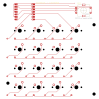
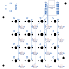
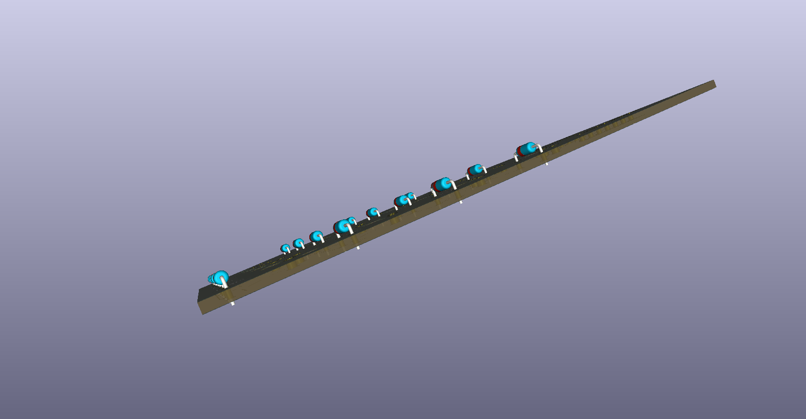
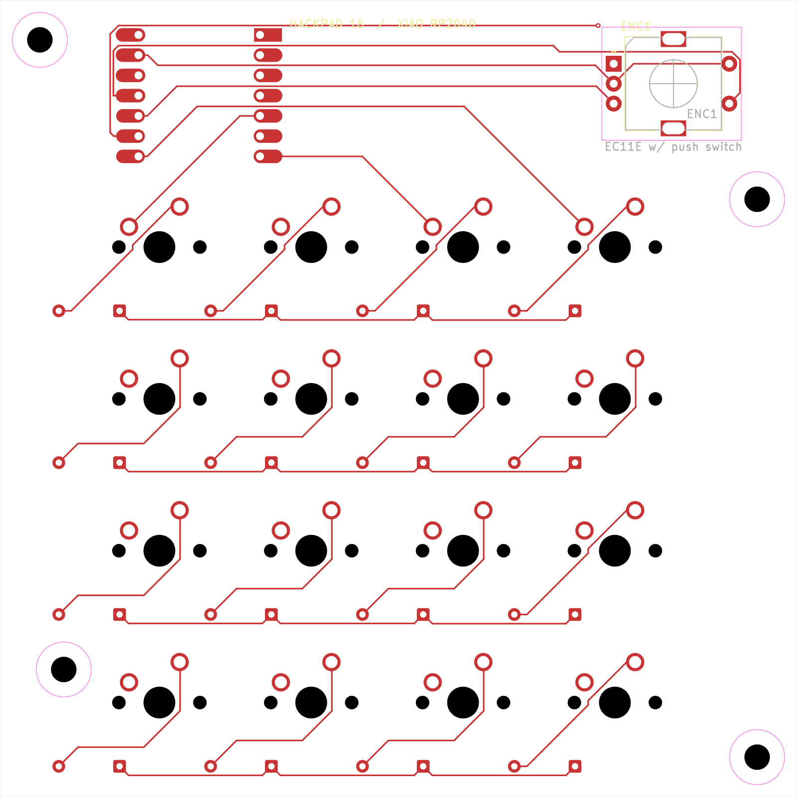
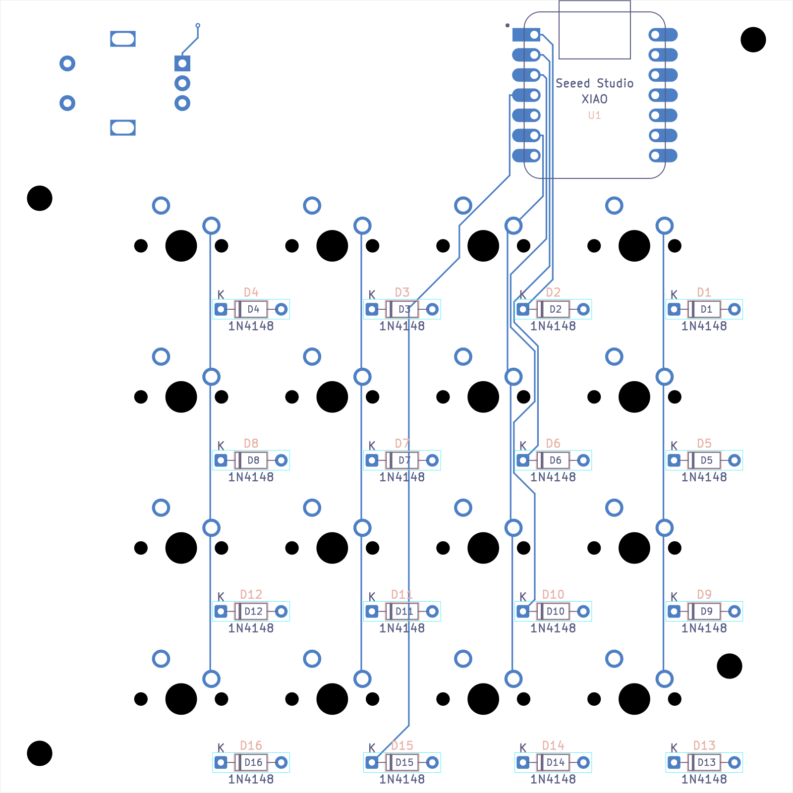
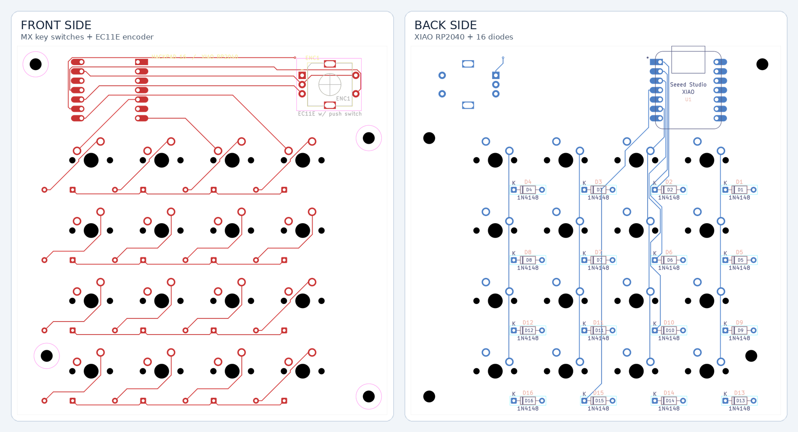
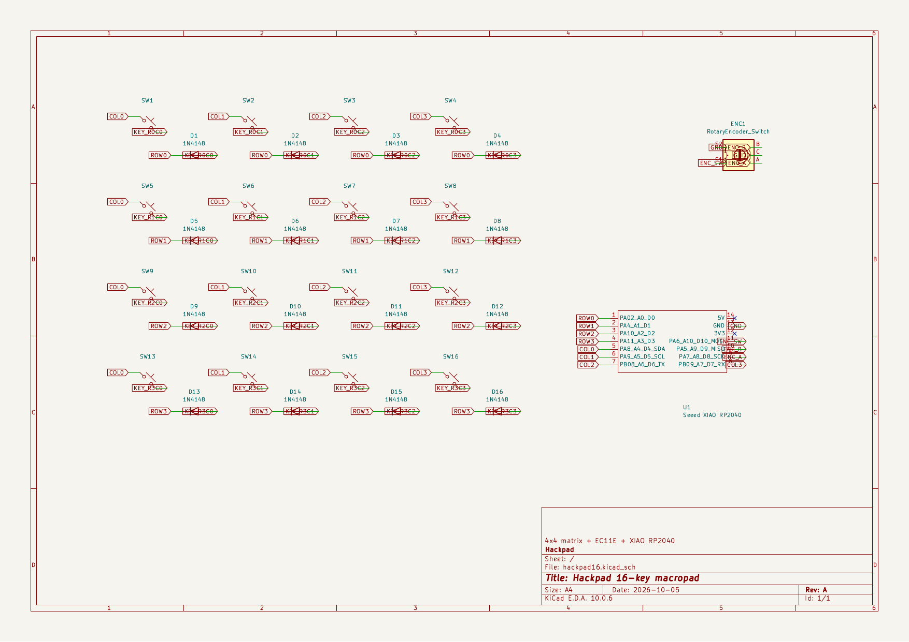
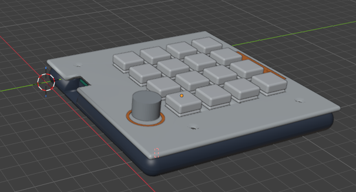
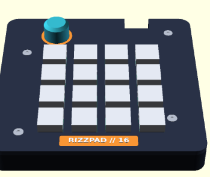
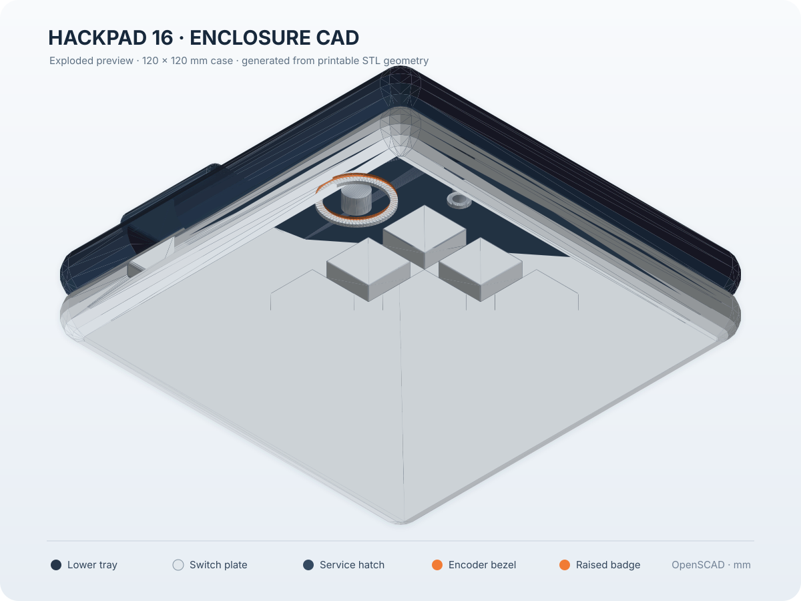

# ASWM Macropad

16-key RP2040 macropad with rotary encoder, custom PCB, firmware, and printable enclosure.

[CAD source and STL files](CAD/openscad_design/README.md) · [Firmware](Firmware/README.md) · [Bill of materials](BOM.csv) · [Schematic PDF](PCB/hackpad16_schematic.pdf)

## Gallery

| | | |
|---|---|---|
|  |  |  |
|  |  |  |
|  |  |  |
|  |  |  |
|  |  |  |

## Pin map

| Function | Signals | GPIO |
|---|---|---|
| Display mux optional | SDA / SCL | GPIO8 / GPIO9 |
| Neon lighting | WS2812B data | GPIO4 |
| Rotary encoder | A / B / switch | GPIO5 / GPIO6 / GPIO7 |
| Top keys | SW1 / SW2 | GPIO1 / GPIO2 |
| Mid keys | SW3 / SW4 / SW7 | GPIO42 / GPIO41 / GPIO40 |
| Bottom keys | SW6 / SW8 / SW9 | GPIO39 / GPIO38 / GPIO21 |
